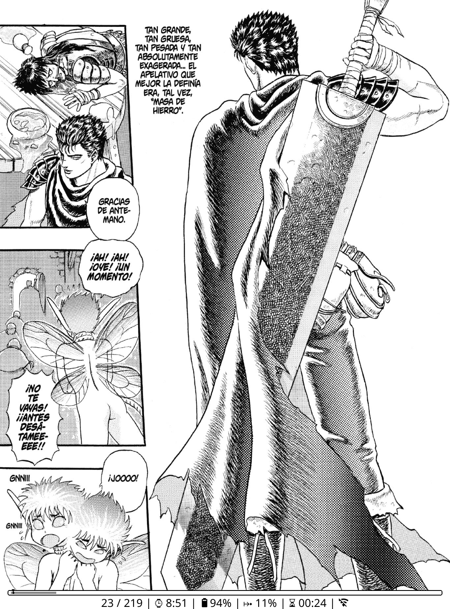
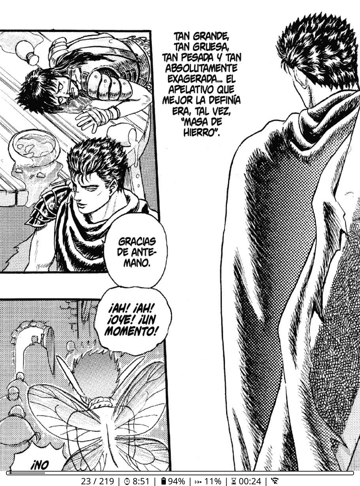

# LeadingMangaZoom for KOReader

> Forked from [Maximum](https://github.com/Shac0x/maximum.koplugin) by [@Shac0x](https://github.com/Shac0x)

A KOReader plugin for reading fixed-layout pages up close: manga and comics, but also newspapers, magazines and textbook PDFs.

- **Manga & comics:** two-finger tap a quadrant to zoom into it, then swipe or tap through the quadrants in reading order (RTL supported).
- **Newspapers & magazines:** spread to zoom freely, drag in any direction to read across columns and articles, pinch to zoom back out.

---

## 🚀 Features

- **Quadrant Zoom**: Two-finger tap anywhere to instantly zoom into that quadrant.
- **Double-Tap Zoom** (optional): double tap anywhere to zoom in on that spot at the level you choose (1.5× to 4×), double tap again to return. Handy on small e-readers.
- **Quadrant Navigation**: While zoomed, swipe, tap the left/right side of the screen or press the page buttons to move to the next quadrant, continuing onto the next page.
- **Free Zoom**: Spread to zoom in as far as you like (repeat to go further), drag or swipe to pan in any direction (diagonals included), pinch to zoom back out. Made for newspapers, magazines and textbooks, and handy for manga too.
- **Desktop Controls**: Ctrl + mouse wheel or Ctrl +/− to zoom, the wheel to scroll, Ctrl 0 to return to the page, like Okular and other desktop readers.
- **Updates from inside KOReader**: *Leading Manga Zoom › Updates* checks GitHub, shows what's new and installs the latest release, no computer needed.
- **E-ink Friendly**: Panning redraws once when you lift your finger, so the screen doesn't flash while you move around.
- **RTL Support**: Toggle Right-to-Left reading direction for authentic manga navigation.
- **Landscape Handling**: 
    - **Auto-rotate**: Automatically rotates double-wide pages to fill your screen.
    - **Page Split**: Splits landscape pages into two logical pages (Left then Right, or vice versa).
- **Format Support**: Extensive support for all common comic book and manga archives.

---

## 📱 Screenshots

  
  

  <i>Normal page view (Left) vs. Quadrant-zoomed view (Right)</i>

---

## 📖 How to Use

1. **Open a Supported Document**: Open any compatible comic archive or PDF.
2. **Two-Finger Tap**: Tap on any of the 4 quadrants of the screen to zoom in.
    - In **continuous view** (KOReader's scroll mode), the quadrants are quarters of the screen as you see it, even when it shows the end of one page and the start of the next. Moving between quadrants follows the screen across pages, and after the last quadrant the next screen starts at its first.
3. **Move Between Quadrants**: While zoomed in:
    - **Swipe** left/right to go to the next/previous quadrant in reading order, or up/down to go to the quadrant below/above.
    - **Tap** the left or right third of the screen to go back or forward (mirrored in RTL mode).
    - **Page buttons** step through quadrants too. Going past the last quadrant turns the page and zooms into the first quadrant of the next page.
    - Turn this off with **Swipe/tap to move between quadrants** in the menu.
4. **Single Tap**: Tap the middle of the screen while zoomed in to return to the full-page view (anywhere, if quadrant navigation is off).
5. **Free Zoom (newspapers, magazines, textbooks)**:
    - **Spread** zooms in on the spot between your fingers; the wider you spread, the more it zooms. Spread again to zoom further (up to 8× the fitted page). Spreading on a zoomed quadrant switches to free zoom.
    - **Drag** with one finger to move around the page in any direction; the screen redraws once when you lift your finger. A quick **swipe** pans the same way, in any direction including diagonals, so you can jump straight to the next article.
    - **Pinch** zooms out step by step; pinch back to about full-page size to return to the page view. A **tap** also returns to the page view.
6. **Double-Tap Zoom** (off by default): turn it on in **Leading Manga Zoom › Double-tap to zoom** and pick a **Zoom level** from 1.5× to 4×.
    - **Double tap** anywhere to zoom in on that spot; double tap again to go back to the page. From there you can drag, swipe and pinch as usual.
    - KOReader normally ignores double taps. This option turns them on for supported books only, which makes single taps (like page turns) wait a moment to check for a second tap.
    - Your choice and zoom level are remembered for all books.
7. **On a computer** (KOReader for Linux, macOS or Windows):
    - **Ctrl + mouse wheel** up/down zooms in/out, keeping the spot under the mouse pointer in place. **Ctrl +** and **Ctrl −** (main keys or keypad) zoom around the middle of the window.
    - **Mouse wheel** scrolls up and down while zoomed in; **Shift + wheel** (or a sideways wheel/trackpad swipe) scrolls left and right. When you're not zoomed in, the wheel turns pages as usual.
    - **Click and drag** moves the page around, like dragging with a finger.
    - **Ctrl 0** or a click returns to the full page.
8. **Zoom modes**: Picking a zoom mode from KOReader's bottom menu while zoomed in switches straight to that mode.
9. **Manage Settings**: Access the **Leading Manga Zoom** menu from the main KOReader menu.
    - *Tip: Hold any menu option to set it as the default for all future books. (Double-tap zoom and its level are always remembered.)*

### Gestures you've already set up

You don't need to change KOReader's *Gesture manager*. On supported documents the plugin goes first only while it has something to do, and otherwise lets your own actions run:

| Gesture | Plugin uses it | Otherwise |
|---|---|---|
| Spread | Zoom in (when Page Zoom is on) | Your action |
| Pinch | Zoom out, while zoomed in | Your action |
| Drag / swipe / short diagonal swipe | Pan (free zoom) or move between quadrants, while zoomed in | Page turns or your action |
| Two-finger tap | Quadrant zoom (when Grid is on) | Your action |
| Double tap | Zoom in or out (when Double-tap zoom is on) | Your action |

Reflowable books (EPUB, MOBI, PDFs with Reflow on) are never touched, so font-size gestures and the like keep working there.

---

## 🛠 Supported Formats

LeadingMangaZoom is optimized for **fixed-layout** documents. It supports:
- **CBZ** (.zip)
- **CBR** (.rar)
- **CBT** (.tar)
- **CB7** (.7z)
- **CZB** (.czb)
- **PDF** (.pdf)

> [!NOTE]
> **Why no EPUB/MOBI?** These are "reflowable" formats. Because the content isn't fixed in place, quadrant-based zooming isn't possible. For the best experience, use [Kindle Comic Converter](https://kcc.do/) to convert your manga to **CBZ** or **PDF**.

---

## 📥 Installation

1. Download **leadingmangazoom.koplugin.zip** from the [latest release](https://github.com/Auri3l/leadingmangazoom.koplugin/releases/latest).
2. Extract it into KOReader's `plugins/` folder, replacing any older copy. You should end up with `plugins/leadingmangazoom.koplugin/main.lua`, not a folder inside a folder.
    - **Kobo / Kindle / PocketBook:** `koreader/plugins/` on the device.
    - **Android:** `koreader/plugins/` in internal storage (or wherever your KOReader data folder is).
3. Restart KOReader. The plugin appears as **Leading Manga Zoom** in the main menu and in *Plugin management*.
4. Make sure **Reflow** is off for the document.

### Updating

From v1.5.0 on, the plugin updates itself. Open a book, then go to **Leading Manga Zoom › Updates › Check for updates**. If there's a newer release, you'll see what's new; tap **Update**, then **Restart**. Wi-Fi is turned on if needed.

- **Check automatically once a day** (off by default) looks for a new version when Wi-Fi is already on, and never turns Wi-Fi on by itself.
- The update downloads the release's `leadingmangazoom.koplugin.zip`, checks that it really is this plugin and the version it claims to be, and only then replaces the plugin's files. If anything goes wrong, your installed version is left as it was and you'll see why.
- To update from v1.4.1 or older, install v1.5.0 by hand once, as above.

> [!TIP]
> Downloading the source code zip from GitHub instead gives you an extra outer folder (`leadingmangazoom.koplugin-master/`). Copy only the inner `leadingmangazoom.koplugin` folder, or the plugin won't show up.

---

## 🤝 Credits

- Based on [maximum.koplugin](https://github.com/Shac0x/maximum.koplugin) by [@Shac0x](https://github.com/Shac0x)
- Auto-rotate logic inspired by [koreader-autorotate](https://github.com/Extraltodeus/koreader-autorotate) by [@Extraltodeus](https://github.com/Extraltodeus)
- Update feature modelled on [Bookshelf](https://github.com/AndyHazz/bookshelf.koplugin)'s in-app updates
- Free zoom requested and tested by [@shuvashish76](https://github.com/shuvashish76), with thanks to [@Euphoriyy](https://github.com/Euphoriyy) ([KOReader.patches#26](https://github.com/Euphoriyy/KOReader.patches/issues/26))

## 🧪 Developer checks

From the repository root, run `luajit tests/run.lua` or `lua5.1 tests/run.lua`.
The tests use small KOReader doubles; they do not replace validation on an e-reader.
To also exercise KOReader's real touch-zone ordering and gesture dispatch, run
`KOREADER_SOURCE=/path/to/koreader luajit tests/run.lua`.

Device checks before release: with Reflow disabled, try two-finger tap, spread,
pinch and tap-to-collapse; enable splitting on an already-open landscape page;
navigate both ways through consecutive spreads in LTR and RTL, using touch and
physical buttons; disable splitting and check that the previous view returns.
Maximum can remain installed, but enable only one plugin's overlapping gesture
features at a time if both are configured to handle the same gesture.

---

## 📅 Changelog

### v1.5.3 (2026-10-29)
- **Continuous view zooms what you see** ([#20](https://github.com/Auri3l/leadingmangazoom.koplugin/issues/20)): when the screen shows parts of two pages, quadrant zoom used to divide KOReader's "current page" (the top one) into quarters, so tapping the bottom of the screen could zoom into the wrong page. Quadrants are now quarters of the screen, on whichever page each one shows. Moving between quadrants crosses pages, and going past the last one scrolls to the next screen.
- Spread, double tap and desktop Ctrl + wheel in continuous view now zoom into the page under your fingers or pointer, not the top page.
- Returning from any zoom in continuous view puts the view back exactly where it was scrolled, instead of at the top of a page.

### v1.5.2 (2026-10-18)
- **Double-tap zoom stays on**: turning it on is now remembered for all books. Before, tapping the option only turned it on for the open book, so it seemed to switch itself off after closing the book (reported on a Kindle Paperwhite). The other options keep working as before: tap for this book, hold to set the default.

### v1.5.1 (2026-10-18)
- **Double-tap to zoom** ([#12](https://github.com/Auri3l/leadingmangazoom.koplugin/issues/12)): double tap anywhere to zoom in on that spot, double tap again to return. Choose the zoom level (1.5×, 2×, 2.5×, 3× or 4×) in the menu. Off by default. While on, the plugin turns on KOReader's double taps for supported books, so single taps wait briefly for a possible second tap.

### v1.5.0 (2026-10-18)
- **Update from inside KOReader**: *Leading Manga Zoom › Updates* checks the latest GitHub release, shows its notes, downloads and installs it, then offers to restart. KOReader has no plugin store, so this replaces downloading and copying the zip by hand. Optional daily check, off by default, which never turns Wi-Fi on by itself.
- The download is checked before anything is replaced: it must be a release zip of this plugin, contain its main files, and carry the expected version. It's unpacked into a temporary folder first, so a broken download can't leave the plugin half-updated.
- The plugin menu now opens for any book, so About and Updates are always reachable. Reading options still need a supported file.

### v1.4.1 (2026-10-18)
- **Ctrl + wheel zooms at the mouse pointer**: the spot under the pointer stays in place, like Okular, instead of zooming into the middle of the window.
- **Keypad + and −** now work with Ctrl (and keypad 0 for Ctrl 0). KOReader's desktop builds didn't recognise these keys at all.

### v1.4.0 (2026-10-17)
- **Desktop controls** ([Euphoriyy/KOReader.patches#26](https://github.com/Euphoriyy/KOReader.patches/issues/26)): Ctrl + mouse wheel and Ctrl +/− zoom in and out, the mouse wheel scrolls while zoomed (Shift + wheel or a sideways wheel scrolls horizontally), and Ctrl 0 returns to the page. Previously the wheel always turned the page, even while zoomed. Ctrl + wheel and the keys follow the *Page Zoom* setting.

### v1.3.1 (2026-10-15)
- Quadrant swipes now take priority over KOReader's link swipes while zoomed in. With *swipe to go back* or *swipe to follow nearest link* turned on, those swipes used to leave the quadrant instead of moving to the next one.
- Closing a book while zoomed in no longer replaces its zoom mode with the temporary free zoom.

### v1.3.0 (2026-10-15)
- **Free zoom for newspapers and magazines** ([Euphoriyy/KOReader.patches#26](https://github.com/Euphoriyy/KOReader.patches/issues/26)): spread zooms by how far your fingers move instead of a fixed 2×, and can be repeated; pinch zooms out step by step. One-finger drags and swipes now pan freely in both directions, instead of KOReader's guided stepping that jumped back to a page corner whenever the direction changed. Panning redraws once on release to avoid e-ink flashing.
- Gesture manager actions keep working: the plugin only claims spread, pinch, drags and swipes while it is using them, so there's no need to set them to *Pass through*.
- Free zoom is capped at 8× the fitted page so very large pages (broadsheet PDFs) do not request oversized renders.
- Diagonal swipes pan diagonally while zoomed, including short ones that KOReader's Gestures plugin would otherwise treat as its "short diagonal swipe".
- Fix a crash when opening the zoom tab of the bottom menu while zoomed (`koptoptions.lua: attempt to compare nil with number`). Picking a zoom mode there while zoomed now simply switches to it.

### v1.2.0 (2026-10-10)
- **Quadrant navigation** ([#7](https://github.com/Auri3l/leadingmangazoom.koplugin/issues/7)): swipe, tap the screen sides or use page buttons to move between zoomed quadrants without zooming out. Reading order follows RTL mode, the document's writing direction and KOReader's inverse reading order. Past the last quadrant, the page turns and the first quadrant of the next page is zoomed (not on split spreads). Can be turned off from the menu.
- Page changes made while zoomed (go to page, TOC, links, page buttons with navigation off) now release the zoom, instead of carrying one page's zoom over to the next and restoring a stale pan position later.
- Zoom levels now account for a visible status bar, like KOReader's own zoom modes, so quadrants are no longer cropped at the bottom.
- Tested against KOReader v2026.03 and v2026.07.1.

### v1.1.2 (2026-09-06)
- Load plugin modules by their own paths to avoid crashes and duplicate menus when Maximum or another plugin uses the same module names.
- Give grid, spread, pinch and zoom-collapse taps priority over KOReader's built-in gestures. Disabled features let the original gestures run.
- Handle split-page navigation through KOReader's paging controller for taps, swipes and physical buttons, including backward navigation into the last half of a spread.
- Apply landscape settings to the opening page and immediately after toggling modes. Keep auto-rotate and split defaults mutually exclusive.
- Cancel stale split-page pans on navigation, disabling or closing; preserve the selected half on redraw.
- Restore previous zoom, pan, reading direction and continuous-view state after temporary zooming, and account for screen margins in spread coordinates.
- Preserve the v1.1.1 physical-button fix and let KOReader update its layout when restoring portrait orientation.

### v1.1.1 (2026-07-25)
- **Fixed Physical Button Remapping Issue**: Resolved a bug on devices with physical page-turn buttons (e.g. Kobo Sage, Kobo Libra 2, Kobo Forma, PocketBook, Kindle Oasis) where auto-rotating landscape pages caused physical buttons to invert and kick the user back to the previous page.

### v1.1.0 (2026-07-16)
- **Added CZB Support**: Added `.czb` to the supported fixed-layout comic formats list.
- **Fixed Zoom Coordinate Offsets**: Zooming now accurately aligns to touch centers even when the page is panned.
- **Enhanced Page Split Navigation**: Page split now tracks page numbers to properly reset the half-page panning view when moving to new landscape pages.
- **Added RTL Page Splitting**: Landscape pages in Right-to-Left orientation (e.g. Japanese manga) now split from Right-to-Left.
- **Improved Pinch Gestures**: Enabled pinch-to-zoom-out gesture to collapse both page-zoom and quadrant-zoom views.

---

## ⚖️ License

GPL-3.0 — see [LICENSE](LICENSE).
